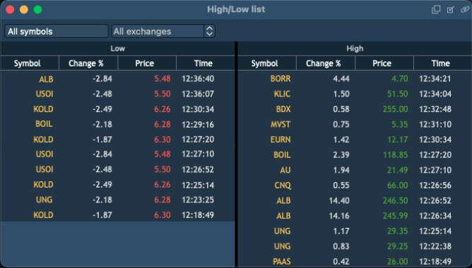
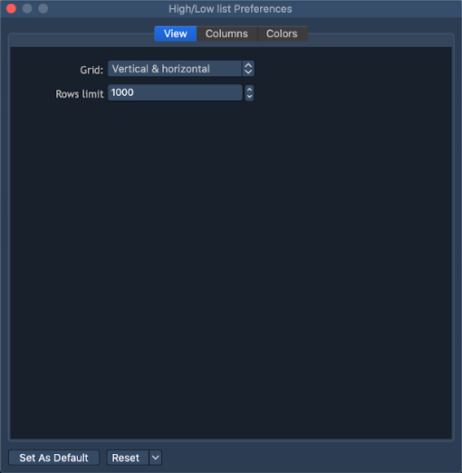
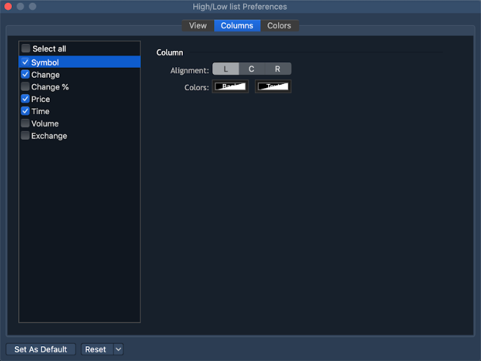
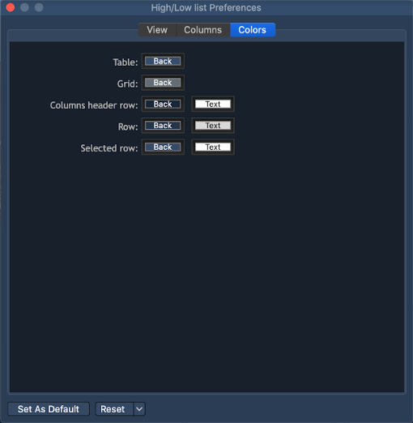

# High/Low list

This panel displays the Low and High lists that contain Instruments, which quote prices reach or exceed the current maximum (day bar "High" price) or minimum (day bar "Low" price) price values.&#x20;

The panel lists are populated with the Instruments, which quotes only exceed the maximum/minimum values or also reach the the maximum/minimum, depending on the algorithm configuration on the server.&#x20;

The panel has the following view:&#x20;

The following common controls are available in this panel:

* Symbols list - drop-down list with checkboxes that contain all Instruments available to the User. Check those Instruments that will be used for populating the panel lists. Multiple selection is available; &#x20;
* Exchanges list - drop-down list with checkboxes that contain all Exchanges available to the User. Instruments selected here will be used for populating the panel lists. Multiple selection is available;

The displayed columns can be configured independently for each panle list. Evoke the settings menu by right-clicking the required list. The following columns are available for displaying:

* Symbol - the Instrument name;
* Change - the absolute value of the Instrument price change;
* Change % - the perecentage value of the Instrument price change;
* Price - the Instrument quote price, which caused the touching/breakdown of the currrent High/Low price (setting the new "High/Low" day bar price);
* Time - the time of the Instrument quote price, which caused the touching/breakdown of the currrent High/Low price;
* Volume - the total Instrument volume at the quoted price, which resulted in the touching/breakdown of the currrent High/Low price;
* Exchange - the name of the Exchange, to which the Instrument is subscribed.

The features of autosizing columns, selecting the type of grid (None, Vertical\&horizontal, Vertical, Horizontal) selection, setting the rows limit and displaying totals/toolbar are available for the panel in the Panel->Settings menu. These settings can be configured for each list separately.&#x20;

### **High/Low list Preferences**

The Preferences window can be opened via the context menu of the panel. The 'High/Low list Preferences' menu contains such sections as View, Columns, Colors.

**View**

* Grid – allows activating and setting up grid. The following types of grid are available: Vertical, Horizontal, Vertical & horizontal, None;
* Rows limit – allows to define the limit of rows to be displayed.

**Columns**

This section allows to set up visibility of columns in the panel and to adjust the following columns' parameters: Alignment, Colors.

**Colors**

This section allows to adjust the coloring scheme for the table panel.

You can set up Background and Text colors for the following elements of the High/Low list:

* Table (background color);
* Grid (background color);
* Columns header row;
* Row;
* Selected row.
