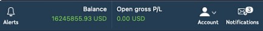
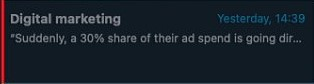

# Notifications

The Notifications panel displays the history of all received messages addressed to this User sorted by their categories. In order to open this panel, click the envelope icon in the terminal’s header, it is located on the right from the Account menu:

<figure><figcaption></figcaption></figure>

Please note that in case the User has some unread messages, this will be indicated in the special circle aside the icon.

The main screen of this panel is divided into two parts: the left section contains toolbar and message cards; the right section displays the message body itself. The general look of this screen is as follows:

<figure><figcaption></figcaption></figure>

### Toolbar

The toolbar is located in the upper left part of the panel, above the message cards:

<figure><figcaption></figcaption></figure>

The categories to which certain messages belong are displayed here. In order to be subscribed to some categories, the User should activate them in the Subscriptions tab (or in the General settings of the application, configured by the admin), that is, the User should have a subscription to a category in order to receive its messages.

Click on the required category to select it, use the arrow on the right to find the categories that didn't fit in the list. Each category has its own color assigned by the admin, uncategorized ones are gray.

When the user selects a particular category, only cards of this category will remain on the left side of the panel, their grouping occurs by name. The rest of the cards will be hidden. To display all cards, regardless of their category, select the “All” item.

### **Message card**

<figure><figcaption></figcaption></figure>

Message card contains topic and preview of the received notification. The time of message receiving is indicated in the upper right corner, it will display simply time in case the message was received today, or time and date in case it was received in the previous dates.

The message card is also colored in category colors, and after reading it becomes a neutral gray color which allows the User to easily identify the status of this message. Even when read, the card will still retain a small colored strip on the left side to indicate that it belongs to one category or another:

<figure><figcaption></figcaption></figure>

### Text field

Right side of the panel displays the main text field, where the topic of the message is at the top and the text itself follows it. To see the full message text click one of the cards from the left part. If no message is selected, the corresponding icon will be shown:

<figure><figcaption></figcaption></figure>

In case the message was not shown as a pop-up in the terminal (can be configured by admin) then it will be marked as unread in the panels’ history. If there are some additional buttons in this message, they will be shown in the history as well.

### Subscription

The user can subscribe/unsubscribe to the required notification categories in two ways. Please note that the subscription method is selected by the admin in the BackOffice.

The first way to subscribe is a standard Subscriptions panel, you can find more about how it works in the [appropriate article](../account-management/products.md). If this method is selected then notification categories will appear as standard subscription cards in this tab. The user should only select the category of interest to him and subscribe to it by clicking the appropriate button.

The second way to subscribe to notification categories is through General settings. In case when admin selects this method, the corresponding tab will appear in the General settings section:

<figure><figcaption></figcaption></figure>

The user should simply check the boxes of categories of interest to him and the subscription will be made, the user will receive all notifications from this category.
