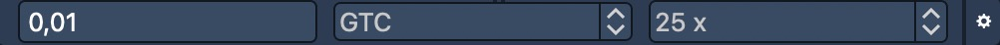
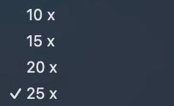
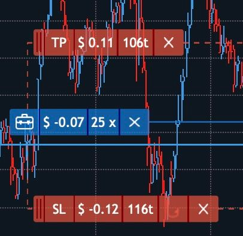

# Visual trading

A user can perform trading directly from the chart panel. It is possible to send orders, modify and close/cancel all positions/orders directly from the chart.

.png>)

### **The built-in Order entry panel**

In order to start visual trading, click on the 'Chart Order entry' button, located on the top right corner of the Chart toolbar, and built-in Order entry panel will be opened:

The Order entry panel consists of the following items:

1\. Quantity – the order quantity;

2\. Validity – allows specifying order validity by selecting among the following time frames: Day, GTC, IOC, GTD, FOK, GTS;

3\. SL – for specifying Stop Loss parameters;

4\. TP – for specifying Take Profit parameters.

Hot buttons for one-click trading are the following:

* Sell Ask – to send a Sell Limit order at the Ask price;
* Sell Bid – to send a Sell Limit order at the Bid price;
* Sell Market – to send a sell market order;
* Buy Market – to send a buy market order;
* Buy Ask – to send a Buy Limit order at the Ask price;
* Buy Bid – to send a Buy Limit order at the Bid price;
* Close – to close all positions by selected symbol and account;
* Reverse – to reverse all positions by selected symbol and account;
* Cancel buy – to cancel buy orders by selected symbol and account;
* Cancel sell – to cancel sell orders by selected symbol and account;
* Cancel all – to cancel all orders by selected symbol and account.

### Chart trading

To start chart trading, follow these steps:

1. Оpen the built-in Order entry panel;
2. Click on the 'Mouse trading' button to enable the chart trading.

You can enable chart trading by pressing and holding the Ctrl key as well.

If the cursor is higher than the current price, you can send:

* Buy Stop order – by left-click;
* Sell Limit order – by right-click.

If the cursor is lower than a current price, you can send:

* Buy Limit order – left-click of the mouse;
* Sell Stop order – right-click of the mouse.

Orders tooltips are always visible while trading: if order is Buy, then its icon is blue; and if order is Sell, then its icon is red.

### Order modifying

To change the order’s price, simply drag and drop the order markerto the desirable price.

If you need to set SL/TP to the order/position, left-click on the order/position marker. After that, SL/TP markers appear:.

Drag and Drop SL/TP prices to modify them:

There is a possibility to make the SL order Trailing stop by pressing the 'Hook' buttonlocated in the SL menu.

To cancel order, click on the button.

### Leverage

Leverage is expressed as a ratio, such as 10:1 or 25:1, representing the multiple by which the user's position size exceeds their actual capital. The leverage option can be available via visual trading:

<figure><figcaption></figcaption></figure>

The drop-down list with all leverage options is available by clicking on the leverage value. Maximum by default:

<figure><figcaption></figcaption></figure>

Opened position with leverage looks as follows:

<figure><figcaption></figcaption></figure>


Leverage can’t be changed via visual trading when the position is opened.

