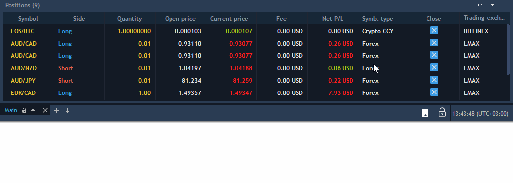

# Positions

Positions panel lists all currently opened positions. When a new position is opened, it will appear in this panel immediately.

To open Positions panel, select Terminal -> Positions:

.png>)

The following columns are available in the panel:

* Account – login name of an account that opened a position;
* Login - login of a user;
* Symbol – a traded symbol (in case the position is opened as a result of corporate action its type is also shown here);


Please note that in this case the User cannot modify/close such position or place SL/TP orders).

Also note that users can disable position closing on double-click in the [General Settings](../getting-started/general-settings.md) panel.


* Symbol description - comments to an instrument;
* Symbol type – a symbol's market category (CFD, spot, stocks, etc.);
* Position ID – a unique number that the trading system assigns to each position;
* Side – type of trade (Long or Short);
* Open price – price at which a position was opened;
* Current price – a market price obtainable from a broker;
* Quantity – amount of a position, either in lots or in units, depending on what is selected in the Settings dialog box;
* Start of day qty. – displays the amount of manually uploaded position at the start of the day;
* Date/Time – date and time when a position was opened;
* Gross P/L – profit/loss in account currency, calculated on base of price difference:

For Long position: Gross P/L = Qty. \* Lot size \* Cross price \* (Current price - Open price)

For Short position: Gross P/L = Qty. \* Lot size \* Cross price \* (Open price - Current price)

P/L for Spreadbet instrument type is calculated depending on price change in ticks:

For Long position: Gross P/L = Qty. \* Bet size \* Cross price \* ((Current price - Open price)/Tick size))

For Short position: Gross P/L = Qty. \* Bet size \* Cross price \* ((Open price - Current price)/Tick size))

Cross price is applied in the case when account currency doesn't correspond to the Betting currency.

* P/L, offset – profit/losses in points;
* Net P/L – profit/loss for a position excluding fee:

Net P/L = Gross P/L - Fee - Swaps

* Position exposure – exposure of a position, in the account currency. Calculated on base of an open price:

Position exposure = Price \* Quantity \* Lot size \* Cross price (quoting CCY > account currency) – calculation for Forex

Position exposure = Price \* Quantity \* (Tick cost/Tick size) \* Cross price (quoting CCY > account currency) – calculation for Futures

In all cases Cross price (quoting CCY > account currency) is a current cross price.

* Net P/L % – displays the percentage of Net P/L relative to the Position exposure calculated in the following way:

Net P/L % = (Net P/L / Position exposure) \* 100%

* Position value – current value of a position. Calculated on base of a current market price:

For Long position: Position value = Position exposure + P/L

For Short position: Position value = Position exposure – P/L

* Fee – shows total commission amount taken for a position;
* Swaps – amounts collected/paid out by a broker when a position is rolled over to a new value date;
* Expiry date – date of contract expiration;
* Strike price – price of option contract performance;
* SL validity - shows the validity (TIF) selected for the order's Stop loss;
* TP validity - shows the validity (TIF) selected for the order's Take profit;
* SL price – Stop loss price set for a position;
* TP price – Take profit price set for a position;
* SL, value – shows a Stop loss sum in account currency which a trader risks by each symbol, if Stop loss triggers. Also, SL sum by all positions are output in Totals on the bottom of the panel, in order to know how much trader can lose;
* SL limit price – Limit price set for SL order;
* Leverage - contains leverage value, if applicable;
* Accrued interest - interest accrued on position. Note that the value is rounded to account currency accuracy;
* Strategy ID – identifier of an execution strategy that opened position.

**Displaying totals considering account currency**

The totals are calculated taking into account the account currency according to the filtering results:

* If the filtered entries belong to accounts with the same currency, then the totals are displayed in the account currency.
* If the filtered entries belong to accounts with different currencies, then the totals are displayed in the server currency.

### **Buttons toolbar**

The most important functions related to Positions can be viewed as buttons in the toolbar of the panel.

* Breakeven – allows modifying Stop loss orders to breakeven;
* Close all – closes all opened positions;
* CLX all – closes all opened positions and cancels all orders;
* Reverse all – reverses all positions;
* Close negative – closes the positions with negative P/L;
* Close positive – closes the positions with positive P/L;
* Close – closes all positions by selected symbol and account;
* Close selected – closes all selected positions;
* Reverse – reverses positions by selected symbol and account;
* Reverse selected – reverses all selected positions;
* CLX – closes opened positions and cancels orders by selected symbol and account;
* Close long – closes the positions with Side = Long;
* Close short – closes the positions with Side = Short.

To select the buttons to be displayed, simply right click on the toolbar of the panel and choose the needed buttons from the menu. The following hot buttons are checked by default: Close all, CLX all, Close negative, Close positive, Close selected and Reverse selected.


Clicking on these buttons doesn't evoke confirmation screens, even if confirmations are enabled in the 'General settings'.


### **Context menu**

The following functions can be realized through context menu:

<figure><figcaption></figcaption></figure>

* Modify position – allows adding SL/TP orders to selected position manually;
* Modify SL to breakeven – allows modifying Stop loss orders to breakeven;
*   Quick SL/TP – allows quick adding SL/TP orders to selected position;

    

These items can be disabled in case the volume of the opened position exceeds the Maximum lot set by the admin, i.e. the Max lot has been reached.

* Close position:
  * Close position by Mkt – allows closing selected positions by Market price;
  * Close position via OE - opens Order Entry panel to close the selected position;
* Symbol info - opens the Symbol Info window for the instrument of the selected position;
* Close position – allows closing all selected positions, all positions by selected symbol, all positions by selected account, all positions;
* Reverse – allows reversing all selected positions, all positions by selected symbol, all positions by selected account, all positions;
* View – allows to show total values and to show toolbar;
* Exercise options – sends an exercise request for the Option position. Available for single positions opened for Options with Exercise style=American, inactive for multiple selected positions.

After clicking this menu item, a confirmation dialog box is displayed with the Position ID, Symbol, Side, Quantity to close, Open price, Current price, Gross P/L to close, Account, Date/Time position parameters.

Clicking the "Exercise" button in the confirmation box, creates a request for the Option exercise, which switches the position to Pending exercise status and prevents performing the following operations for the position: **Modify position, Modify SL to breakevent, Quick SL/TP, Close position, Reverse.**

The mentioned actions are reenabled for the position after the "Cancel exercise" action is performed.\
Also note that broker can prohibit American-style options from being exercised if the strike price is out of the money.

* Cancel exercise – cancels an exercise request for the selected Option position with Pending exercise status. Available for single positions opened for Options with Exercise style=American, inactive for multiple selected positions.

After clicking this menu item, a confirmation dialog box is displayed, which requires a confirmation of canceling an Option exercise request. After the exercise Option request is canceled, the **Modify position, Modify SL to breakevent, Quick SL/TP, Close position, Reverse** operations become allowed for the position.

* Modify product type – this tab allows adding SL/TP orders to the selected position manually as well as modify quantity and change the target product type.


The tab is available only when both _Intraday_ and _Delivery_ trading modes are available for the Instrument/Account pair. Also for Positions with "Net by average price" netting type. Product type modification should also be allowed for this user.

The user can also have _Positions close only_ or _Liquidation only_ status depending on his plan. In this case, product type can not be modified and an appropriate reject message is sent to the user.


The following controls are available in this tab:

<figure><figcaption></figcaption></figure>

* Target product type – drop-down list for selecting the new target product type;
* Modify quantity – switchable numeric for indicating the Qty to be modified. The default value is _Modify quantity = Quantity - Start of day qty_, please note that this value cannot be greater than _Today traded qty_. In case this numeric is enabled, SL/TP price controls are automatically disabled;
* SL/TP price – Stop loss and Take profit prices that are available for modification. These controls are disabled in case the “Modify quantity” control is active;
* SL/TP offset - provides information about the Stop Loss (SL) and Take Profit (TP) settings, including _Profit/Loss in account currency_ and _Profit/Loss as a percentage_ in brackets.

When changing the Product type, all SL/TP orders will be canceled and the corresponding error will be displayed:

 (1).jpg>)

If **Quantity > Maximum lot** set by the admin, the user will receive the following warning:


Quantity is greater than Maximum lot. Orders will be created to close the position.


In case a commission is charged for closing a position, it will be charged for each order into which the position was split.

### Mutual closing

The user can mutually close two positions one by another if this feature is available to him. In order to do this, the user should select two positions (with a pressed Shift button), then right-click on one of them to open the context menu and select the Mutual close option:

<figure><figcaption></figcaption></figure>

Please note that Mutual closing can be carried out when two positions for the same instrument are selected. The following conditions must be met in order for a mutual closing to be available:

* Positions to close must be selected for the same instrument;
* These positions must be oppositely directed (i.e. both Long and Short positions must be selected);
* In case the partial close is forbidden for this account, then the amount on both sides (Long and Short) must be equal;
* Only two positions can be selected;
* All positions must belong to the same account.
