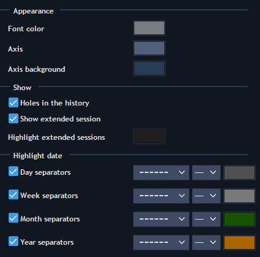
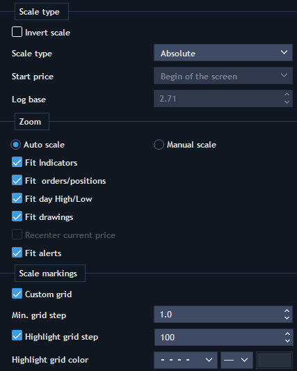
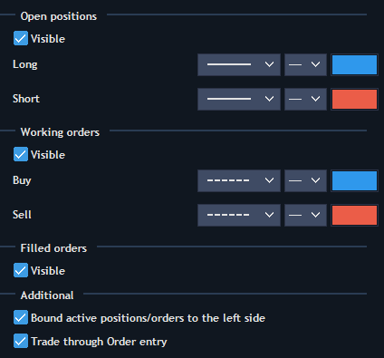

# Chart settings

Chart settings can be opened through the context menu of the Chart panel:

#### **Data style**

.png>)

* Style - describes price movements of a symbol. Another way to choose the chart style through context menu: Style -> \[desired style].
* Data type - the way to accept data. Available types are: Bid, Ask, Last and Default by symbol. Based on server settings Last or Bid/Ask type can be disabled.
* Color settings for all styles.

#### View

* Back color - allows setting up the color of the chart background.
* Watermark color - allows setting up the color of the watermark.
* Watermark mode - allows displaying the Symbol/Description watermark (or both) as well as hiding it.
* Crosshair - allows activating and setting up cursor lines, as well as font color of price/time labels.
* Grid - allows activating and setting up grid on the chart.
* Time to next bar - allows activating and setting up color of figures that show remaining time to the next bar.
* Additional - allows activating Drawing toolbar, Scrollbar chart preview, Chart toolbar.

#### **Time scale**

* Appearance - allows setting up style of time scale.
* Holes in the history - allows seeing free space on the chart if there is no history at that moment.
* Show extended session - allows seeing bars from extended sessions on chart. The peculiarities of this setting also depend on the state of the "Use session periods for Intraday chart" setting that can be found in the BackOffice. If “Use session periods for Intraday chart = true”, then the aggregation will start from the first session of the day. At the same time, sessions that belong to the Before market/After market periods will be excluded from the Extended session list.
* Highlight extended sessions - all extended sessions that were set on the server for the current symbol will be displayed in selected color.
* Highlight date - allows displaying separator lines for: Days, Weeks, Months, and Years.

#### **Price scale**

.png>)

* Invert scale - enables the reverse display of the price scale. If checked, the increase in price will be dispayed from top to bottom.
* Scale type - allows selecting type of the price scale and start price for the chart: Absolute, Relative, Logarithmic.
  * Absolute - displays the price scale in the absolute units.
  * Relative - displays the price scale in the relative units, where as a starting point can be used: first point of the screen visibility, point of the day opening, and starting point of the history.
  * Logarithmic - logarithmic scale representation, where as a starting point can be used the same points as for relative scale.
* Start price - you can choose from the following options: Begin of the data, Begin of the day, Begin of the screen.
* Zoom - choose between Manual and Automatic Price scale. In manual mode, changes can be made to the vertical price scale. Automatic mode is based on visible prices but it also can fit Indicators, Orders, Drawings and the day's High/Low prices.
* Scale markings - allows setting up custom grid on price scale, minimal distance assigning in ticks and custom spacing between grid's lines.
* Appearance - allows setting up style of price scale.
* Highlight prices:
  * Price indicator - allows setting up active price marking as:
    * Scale marker
    * Scale marker with line
    * None
  * Ask price color
  * Last price color
  * Bid price color
* Display Heiken Ashi value instead of last price - if checked, only the Last price is displayed on the price scale. If unchecked, both the Last price and the calculated Close value according to the selected aggregation type are displayed (available only for charts with Heiken Ashi style);
* Spread type - allows setting up the way of spread displaying:
  * None
  * Area
  * Line (Bid and Ask)
  * Line with price (Bid and Ask)
  * Price

If spread type is None, then single price indicator will be shown, depending on chart data type (Bid, Last, Ask etc.)

* Spread area color - color of spread area (if it's chosen as spread type).
* Previous close line - type and color. Available only for Time, Tick, Price range and Heikin Ashi aggregation types.
* Day High/Low lines - type and color. Available only for Time, Tick, Price range and Heikin Ashi aggregation types.
* Settlement price - allows displaying settlement price on the chart and choosing the style of its line.
* Previous settlement price - allows displaying previous settlement price on the chart and choosing the style of its line.

#### Alerts

.png>)

* Notification – allows selecting the type of notification sent after alert triggering, the following types are available: Email, Push, Pop-up, Sound;
* Importance – allows to define the importance of the alert. The following options are available: High, Medium, Low;
* After execute – allows to select alert behavior after execution. Available options are: Stop or Remove.

#### **Visual trading**

* Open positions - allows displaying opened positions on chart and setting up style of lines.
* Working orders - allows displaying working orders on the chart and setting up the style of lines.
* Filled orders - allows displaying filled orders on chart.
* Additional - allows displaying active positions/orders on the left side of the Chart area and trading through Order entry.

#### **Chart Order entry**

.png>)

This section allows choosing buttons and hot buttons which will be displayed in built-in Order entry.

#### **Info window**

<figure><figcaption></figcaption></figure>

This section allows setting up contents of the Info window and the style of its displaying. You can select from the following Info Window Modes: Separate Window, Attached To Cursor, Hidden.


Please note that this setting allows changing the background and text colors for various info windows, for example, those that are expanded when using the 'Right information button' on the chart.


Other settings sections (Volume bars, Price statistics, etc.) are described in the articles located in the 'Analysis tools' documentation section.
