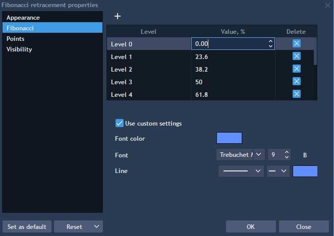

# Fibonacci tools

Fibonacci tools help a trader to analyze trends in the price chart and predict the next price. When the price goes up, Fibonacci tools act as resistance levels, and vice-versa. In Velocity Trader platform the following tools are represented:

* Fibonacci retracement – retracement and price goals;
* Fibonacci expansion – estimating support and resistance levels;
* Fibonacci arc – places arcs with Fibonacci levels;
* Fibonacci ellipses – identifies underlying structure of price movements;
* Fibonacci spiral – places a spiral with Fibonacci levels as steps;
* Fibonacci fans – places Fibonacci angles;
* Fibonacci phi-Channel – places Fibonacci levels on a trend line;
* Fibonacci time goal analysis – places time goals;
* Fibonacci time zone – measures Fibonacci periods.

### Settings

The following sections are available in the Settings menu: Appearance, Points, Visibility, Fibonacci.

Fibonacci tab allows to add, delete Fibonacci levels, edit their values and to set up the font, font color and width of a line of a drawing which will be colored after reaching the value which you set:

<figure><figcaption></figcaption></figure>

&#x20;
