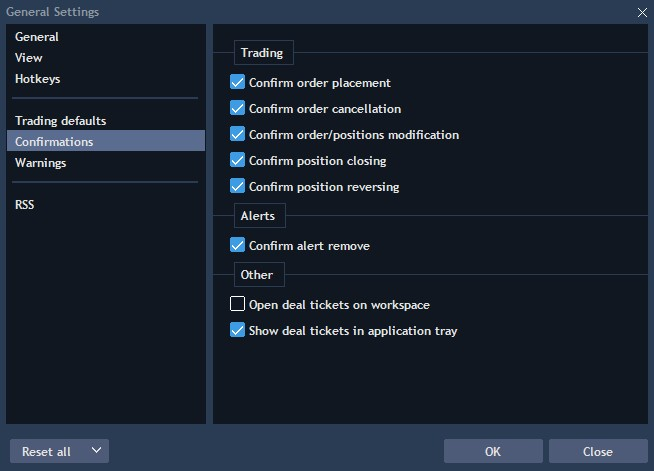
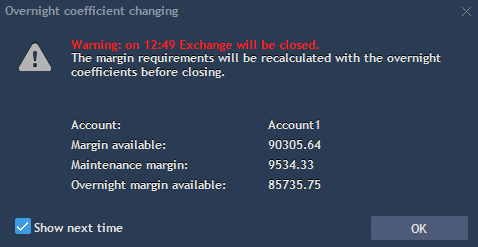

# General settings

The General Settings menu is used to customize and change general properties of VelocityTrader App. To open it, click on the  button at the bottom of the sidebar of the App.

### **General**

<figure><figcaption></figcaption></figure>

* Language - defines the default language of the UI. To set up your preferred language simply select it from the list;
* Info bar - check to display a comprehensive info bar over your Workspaces;
* Enable sounds - check to allow sound notifications;
* Allow positions closing by double-clicking - if checked, allows closing positions by double-clicking them in the [Positions](../account-management/positions.md) panel;
* Allow orders cancellation by double-clicking - if checked, allows cancelling orders by double-clicking them in the [Working Orders](../account-management/working-orders.md) panel;
* Synchronize cursor - synchs cursor among charts;
* Mouse wheel - select the action to be performed when scrolling the mouse wheel, it's either scrolling or zooming in and out.

### **View**

.png>)

* Rounded average open price – check to round open price of positions in Watchlist, Positions, Filled orders, Market depth and other panels (tick size=instrument tick size);
* Display quantity in lots – check to view orders quantity in lots, uncheck to view in units;
* Abbreviate volumes – check to abbreviate volume values in all panels. For example: 1000 will be displayed as 1K, and 1000000 – 1M;
* Reverse buttons order – check to reverse trading buttons into Sell/Buy pattern;
* Tooltips – check to display all tooltips in the application, uncheck to hide. The function is enabled by default.

### **Trading defaults**

<figure><figcaption></figcaption></figure>

* Account – specifies your default account, for multi-account users only;
* Symbol – specifies your default symbol. The default symbol will be shown whenever you load the Chart panel or the Order entry panel;
* Set SL/TP values in offset (for new orders) – check to display order prices in offset, uncheck to display in absolute values;
* Show offset in – allows to select one of the available modes for offset displaying:
  * Ticks - displays the offset in price ticks;
  * Ticks (fractional ticks for Forex) - fractional ticks for Forex instruments;
  * Points - displays the offset as an absolute value in points;
  * Percent - displays the offset as a percentage of the order price.
* Use stop limit instead of stop – check to place stop limit orders instead of stop orders. When checked activates the 'Limit offset, ticks' field;
* Use stop limit for SL - check to place Stop limit orders instead of Stop orders for Stop loss. When checked, activates the 'Limit offset, ticks' field;
* Limit offset, ticks – use to adjust the default quantity of ticks for offset of a limit price. Active only if 'Use stop limit instead stop' is checked;
* Buy TP trigger price - allows selecting price type for Buy Take profit order trigger;
* Sell TP trigger price - allows selecting price type for Sell Take profit order trigger;
* Buy SL trigger price - allows selecting price type for Buy Stop loss order trigger;
* Sell SL trigger price - allows selecting price type for Sell Stop loss order trigger;
* Select SL/TP trigger price in OE - if active, user will have a possibility to select SL/TP trigger price in Order entry panel;
* Order type – use to specify an order type, available values: Market, Limit, Stop, Stop Limit, Tr. stop, OCO, Manual;
* Market/Limit(Stop limit)/Stop Validity – use to set up validity for Market/Limit (Stop Limit)/Stop orders respectively. Operates in both auto and manual trading;
* SL validity - allows to select the default validity for Stop loss orders from the available validity values for Stop, Stop limit, and Trailing stop orders;
* TP validity - allows to select the default validity for Take profit orders from the available validity values for Limit orders;
* Select SL/TP validity in OE - if checked, allows to select the validity for Stop loss and Take profit orders directly in the Order Entry panel;
* Overnight execution by default - if true, all new orders will be set for overnight execution by default (only for instruments that support overnight trading). If false, overnight execution will be disabled by default.\
  Note this option is visible only if at least one of your accounts supports overnight trading;
* Types manager – use to set your default parameters per order.

Open 'Types manager' to apply additional settings to orders. Select the market - Forex, Futures, Equities, etc. to set the Default lot values. It is also possible to override default lots values for separate symbols by adding them to the symbol types tree using "+" button. In order to apply symbol type default lots settings, just delete symbol from the tree using context menu:

<figure><figcaption></figcaption></figure>

* SL/TP default offset, ticks – specifies a default value of offset field for SL/TP;
* SL/TP default offset, % – specifies a default percentage value for the offset field in SL/TP orders;
* User quantity coefficient – is a default increment applied to all quantity counters;
* Price increment (arrow), ticks – determines the increment value (e.g. the Limit price field in the Order entry panel) when pressing the Up Arrow (^) key;
* Default lots setup – allows enabling default lot sizes for orders of selected symbol types or specific symbols which will be available in OE section;
* Buy TP trigger price - allows selecting price type for Buy Take profit order trigger;
* Sell TP trigger price - allows selecting price type for Sell Take profit order trigger;
* Buy SL trigger price - allows selecting price type for Buy Stop loss order trigger;
* Sell SL trigger price - allows selecting price type for Sell Stop loss order trigger.

If 'Show offset in = Ticks (fractional ticks for Forex)', then options 'SL/TP default offset, ticks' in the Forex instrument type will be displayed in decimal view and in the corresponding format. For example, 10 ticks will be displayed as 1.0, and 50 ticks as 5.0, depending on which value is set in the option. If 'Show offset in' is NOT 'Ticks (fractional ticks for Forex)', values of the options 'SL/TP default offset, ticks' are displayed by default, e.g. 10 ticks, 50 ticks.

<figure><figcaption></figcaption></figure>

### Confirmations

In Confirmations section all of the options are fairly intuitive:

* Confirm order placement - check if you want to confirm each order placement;
* Confirm order cancellation - check if you want to confirm each order cancellation;
* Confirm order/positions modification - check if you want to confirm each order/position modification;
* Confirm position closing - check if you want to confirm each position closing;
* Confirm position reversing - check if you want to confirm each position reversing;
* Confirm alert remove - check if you want to confirm every alert removing;
* Open deal tickets on workspace - check if you want to confirm the opening of deal tickets on a workspace;
* Show deal tickets in application tray - determines whether alerts are displayed in the application tray. If false, deal tickets are not shown in the tray, but remain available in the Event log.

### **Warnings**

<figure><figcaption></figcaption></figure>

* Warn if wrong order – if checked, you will get a warning message in case of placing order with incorrect parameters;
* Warn if today's volume exceeds - allows to select today volume level at which the system will display a warning message;
* Warn if order quantity exceeds – allows to select a quantity level at which the system will display a warning message;
* Warn if order capital exceeds – allows to select an order capital level at which the system will display a warning message;
* Warn if available funds less – allows to select available funds level at which the system will display a warning message;
* Warn if today's gross less – allows to get a warning message in case if a level of today gross is less than in set parameter;
* Show symbol halt warnings – if checked, you will get a warning message in case a trading halt on symbol occurs;
* Warn if close Strategy manager with active strategies – if checked, you will get a warning message in case Strategy manager is closed with active strategies;
* Warn when entering into leverage - if checked, user receives a warning when they begin using leverage in every order confirmation screen. Note that checkbox is available only if the related rule is active for the user's accounts on the server. Also note that the value applies to all of the user's accounts if any account has the rule active;
* Warn if identical subsequent order is placed (sec) – if checked, you will get a warning message in case of placing an identical subsequent order during the specified time period.
* Show overnight margin notification message – if checked, you will get a warning message in case if a position is transferred overnight.

If you have open positions on symbols which have overnight coefficients, you will get overnight margin notification message "Warning: on 12:49 Exchange will be closed. The margin requirements will be recalculated with the overnight coefficients before closing".

The overnight warning message shows the following items: Account (Account for which the margin coefficients are switched to overnight), Margin available, Maintenance margin (based on overnight coefficients), Overnight margin available.

Overnight margin available = Balance + all risks - Overnight total maint. req.

If Overnight margin available < 0, user will get a message "You don’t have enough margin for overnight, we force close some positions and cancel orders".

* Warn when entering into leverage - if enabled, you will receive a warning message indicating that you are about to start using leverage (broker's funds) in every order confirmation screen when your _Available Cash_ is less then zero.

### RSS

Using this settings section, the user can add or edit RSS feeds in order to view news through RSS panel.\
Read more about RSS panel here:

[RSS](../informative-panels/rss.md)_._

.png>)


When there is no Internet connection, users with logging enabled are not allowed to change settings.

