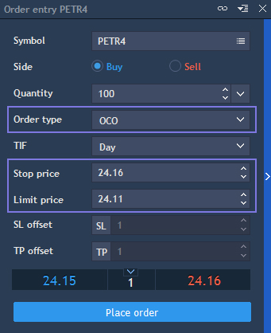
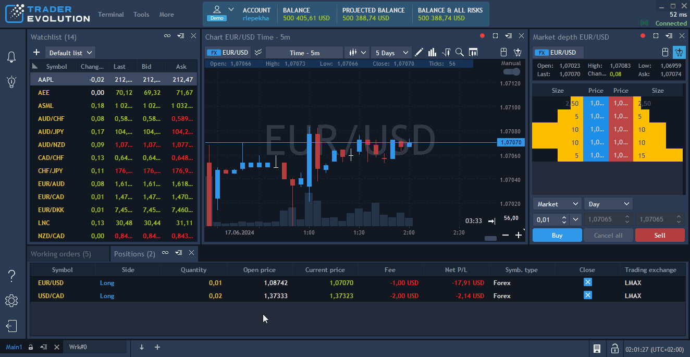
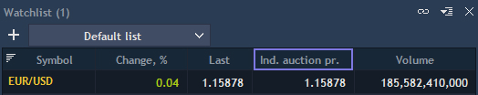
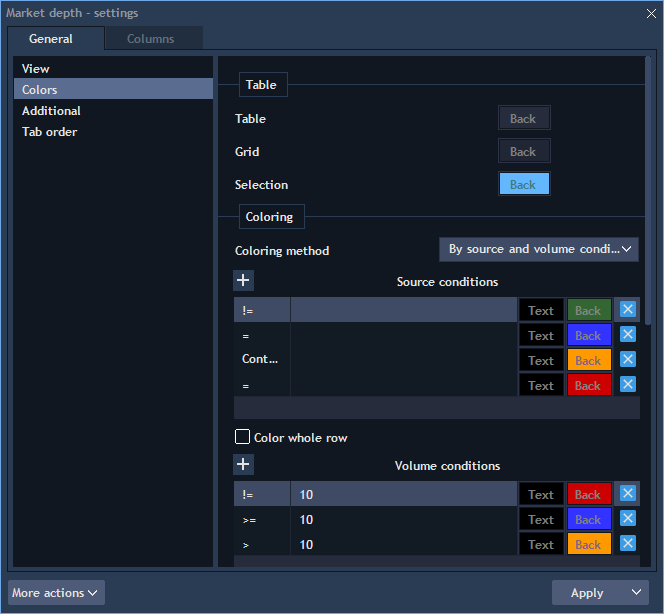
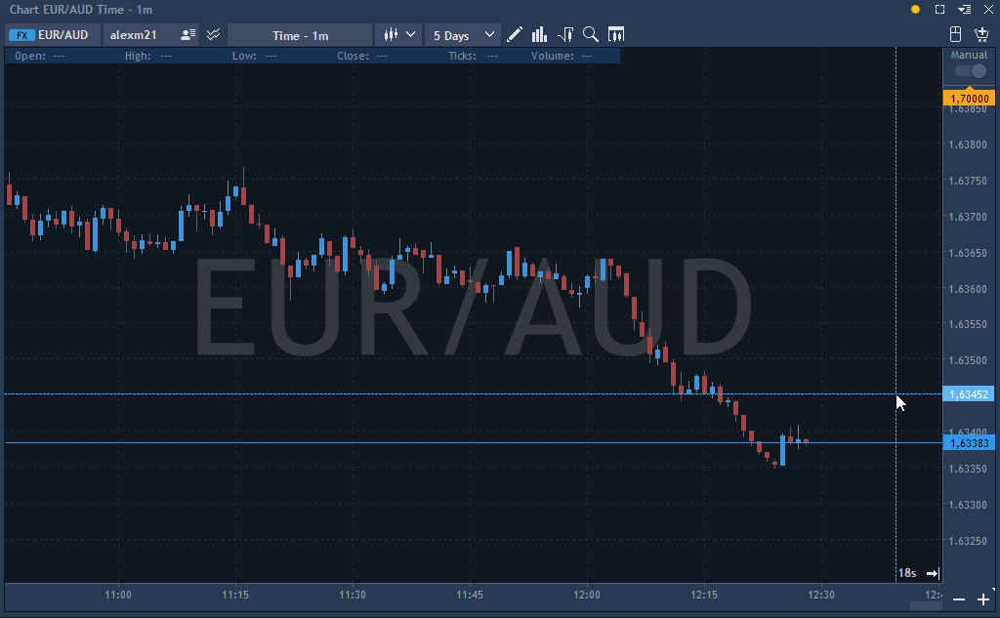
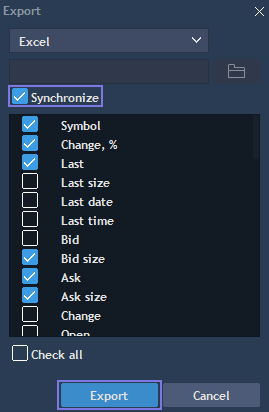
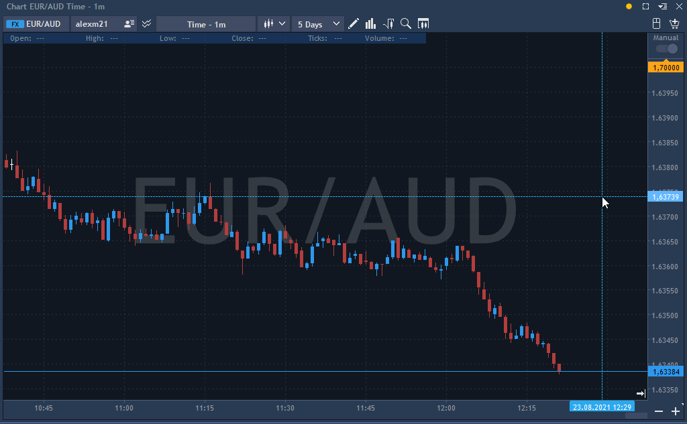

# How to

#### **1. How to reset your password?**

Reset your password following the recommendations from the ‘Changing password’ section:&#x20;

[Installation and login](getting-started/installation-and-updates.md)

#### **2. How to find the Order ID / Position ID?**

1. Open the Positions/Working orders panel;&#x20;
2. Right-click on any column name;
3. Select the Position ID/Order ID from the list.

#### **3. How to execute a partial close?**

* Select the position to be closed from the Positions panel. Right-click and select ‘Close position’;
* You can also double click on the position to call the 'Close position' dialog window. Select ‘Quantity to close’ to execute a partial close of the position;

<figure><figcaption></figcaption></figure>

* Or simply place a reversed order for the same instrument.

#### **4. How to place an OCO order?**

An OCO order is a combination of a Stop order and a Limit order. You can set prices for both of these orders and place 2 orders at the same time:

* Place an OCO order by selecting OCO in the Order type section of the Order entry panel;

* You can also place an OCO order using Visual trading directly on the chart, find more detailed description in the [Visual trading](trading-panels/visual-trading.md) article.


The ability to place OCO orders must be activated in the User's details -> General trading rules section of BackOffice.


#### **5. How to place a trailing stop?**

* Place a Trailing stop order by selecting Trailing stop in the 'Order type' section of the Order entry panel;

.png>)


The ability to place Trailing stops must be activated in the User's details -> General trading rules section of BackOffice.


* To replace a Stop loss by Trailing stop in the Order entry panel, simply click on a specialbutton loacted near Stop loss. The blue color of thebutton indicates that the Trailing stop is activated;&#x20;
* You can place Closing Trailing stop directly from the chart, using Visual trading functionality and modifying an order or a position in the same way. More detailed description in the [Visual trading](trading-panels/visual-trading.md) article.

#### **6. How to add a price alert?**

1. Open the Alerts panel by clicking on the correspondingbutton at the header of the terminal;
2. Setup conditions which will trigger your alert and finally select the actions to be taken.

<figure><figcaption></figcaption></figure>

**7. How to disaggregate the Market depth?**

1. Open settings of the Market depth panel;
2. Select the 'View' section of the 'General' tab. Select the 'By order' option in the drop-down list of the 'View by' setting. Click Apply. &#x20;

**8. How to show filled orders on the chart?**

1. Select the ‘Visual trading’ section in the Chart settings;
2. Tick on the 'Filled orders' box to make filled orders visible on the chart.

#### **9. How to enable VWAP?**

* Click on ‘Analysis tools’ and select the 'VWAP' from the list;
* You can enable VWAP on a Chart, Market depth, Scalper, Matrix and Order Entry panels;
* Read more about VWAP here:&#x20;

[VWAP+](analysis-tools/chart/volume-analysis/vwap.md)

#### **10. How to find a volume by price?**

In VelocityTrader there are few options to view the volume by price:

* The Market depth panel allows to view the volume per each price level;
* Info Window in the Chart panel contains the volume value;
* To plot Volume bars on the chart, select 'Volume bars' in the Analysis tools.

#### **11. How to track the auction price at opening?**

* Right-click on any column name of the Watchlist;
* Select the 'Indicative auction price' from the list;
* A column named 'Indicative auction price' should appear.

#### **12. How to open multiple charts?**

You have two options here:

* Open the Grid panel: [Grid](analysis-tools/grid.md)
* Open several Chart panels: [Arranging panels](getting-started/arranging-panels.md)

#### **13. How to color brokerages in the Market depth?**

1. Open settings of the Market depth panel;
2. Select the ‘Colors’ tab;
3. From the drop-down menu of the ‘Coloring method’, select the ‘By source and volume conditions’ option.

#### **14. How to add a previous close line on the chart?**

1. Open the context menu of the chart panel;
2. Select ‘View’ -> ‘Previous close’.

#### **15. How to plot a chart within the Scalper?**

1. Open the Scalper settings from the context menu of the panel;
2. Open the ‘Time & Sales chart’ tab;
3. Select ‘Trades & Quotes’ from the drop-down list of the 'Mode' section;
4. Apply changes.

<figure><figcaption></figcaption></figure>

#### **16. How to enable DDE Link?**

1. Open the context menu of the desired panel with DDE link;
2. Click on Export and select Excel from the list;
3. Make sure to check the ‘Synchronize’ checkbox;
4. Click Export.

#### **17. How to show time to next bar?**

1. Right-click on the Chart panel;
2. Select ‘View’;
3. Click on the ‘Time to next bar’ option to enable the countdown visible.

#### **18. How to modify a pending order?**

1. Right-click on a pending order in the Working orders panel and select ‘Modify order’;
2. Use the editable boxes to change quantity, order price, time in force, and the OCO order. To specify a new order price, use the Price field; the Current price field shows the market price.&#x20;
3. Click ‘Modify’ when done.

#### **19. How to trade during overnight hours?**

Overnight trading allows you to place and execute orders outside of regular market hours. This feature gives you access to extended trading opportunities, but it is available only for instruments and accounts that support overnight trading.

**1) Enable overnight trading by default**

You can manage your overnight trading preference in **Settings →** [**Trading defaults**](getting-started/general-settings.md).\
Turn on **“Overnight execution by default”** if you want all new orders to be eligible for overnight execution automatically:

<figure><figcaption></figcaption></figure>

\
If this option is disabled, orders will be placed only during regular market hours unless you enable it manually in the Order Entry panel.

> **Note:** This setting is visible only if at least one of your accounts supports overnight trading.

**2) Order Entry panel**

In the[ **Order Entry**](trading-panels/order-entry/README.md) window, you will see the **Overnight execution** switch (if available for the selected account and instrument):

\
Enable it if you want your order to be executed during overnight hours. Stop Loss and Take Profit orders will automatically inherit this setting.\
If the switch is not shown, overnight trading is not supported for the current instrument or account.

<figure><figcaption></figcaption></figure>

**3) Chart trading**

When placing orders directly from the chart, you will see additional icons: .png>) when opening order from the chart Order entry or .png>) using the Visual trading feature.\
Also note that using the Visual trading feature it is possible to drag the standard or overnight icons to set Stop Loss or Take Profit levels:

<figure><figcaption></figcaption></figure>

Tooltips will show whether the order will be executed during or outside regular trading hours.

**4) Market Depth and Alerts**

In the [**Market Depth**](trading-panels/market-depth.md) panel, you can also find the **Overnight execution** switch when available:

<figure><figcaption></figcaption></figure>

In the **Alerts** panel, there is an **Overnight processing** option (visible when the selected instrument and account support overnight trading).\
If enabled, your alert can be triggered during overnight hours:

<figure><figcaption></figcaption></figure>

**5) Saved and Working orders panels**

Orders placed with overnight execution enabled are marked with a small **overnight icon** in the order type column in the **Working orders**, **Saved orders** panels.\
These values cannot be changed after the order is placed:

<figure><figcaption></figcaption></figure>

**6) Confirmation screens and event log**

The **confirmation window** and **event log** include information about whether the order is set for overnight execution.

**Summary**

To trade during overnight hours:

1. Your account and the selected instrument must support overnight trading.
2. Enable **Overnight execution** in the Order Entry panel or activate **Overnight execution by default** in settings.
3. Confirm that the option is displayed before placing the order — if it’s visible, overnight trading is available for you.

> Once enabled, the orders — including SL/TP — can be placed and executed even when the regular market session is closed.
