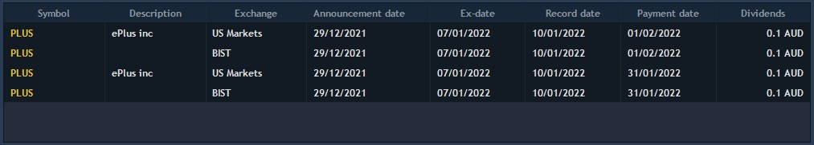
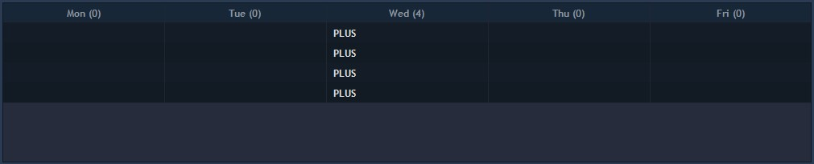

# Dividends calendar

The Dividends calendar panel displays available dividends for different exchanges in an easy-to-use functional calendar. In order to start using the Dividends calendar, select it from the Tools drop-down menu located in the terminal main menu. The general view of this panel is as follows:

.jpg>)

The panel itself includes four parts:

* Filter section – contains a calendar for selecting the week for which the information on dividends will be shown;
* Exchange section – filter control that allows selecting the exchanges for which information on dividends is available;
* Date type drop-down list – allows filtering dividends according to the selected date type;
* Table section – displays the main part of information (described below).

The “Filter section” is located in the upper left part of the panel and contains a calendar that allows displaying information for a specific week, to do this, simply select the required one:

.jpg>)

The “Exchange” section allows displaying information in the table for the required exchanges only, simply check those of interest and the table will be refreshed:

.jpg>)

The “Date type” drop-down list allows filtering dividends displayed in the table by the following criteria: Announcement date, Declaration date, Ex-date, Record date, Payment date.

.jpg>)

Thus, the table will display dividends of the type selected in this drop-down list, for the time period selected in the calendar.

### **Table section**

The “Informational table” section is divided into two parts. The upper one (week part) displays a list of dividends which events fall on the selected calendar week; the lower one (day part) displays a detailed description of dividends for a particular date, which is also selected in the calendar:

Contains the following columns:

* Symbol – displays instrument name;
* Description – instrument’s description;
* Declaration date – date of the announcement of next dividends payment (DD.MM.YYYY format is applied to all dates);
* Record date – dividends are not paid after this date;
* Ex-date – last day for buying objects to receive dividends on them;
* Payment date – date of dividend payment;
* Dividends – displays the amount of dividends to be paid;
* Exchange – displays the name of exchange on which the instrument is traded;
* Announcement date – announcement date of dividend payment;
* Taxation detail rating – shows the tax rate value.

The "Weekly" section of the table contains a list of the weekdays, thus the table is divided into seven columns. The header of each column shows the number of dividends of the selected Date type (ex-date, Record date, etc.) that fall on that day. The column itself contains a list of instruments, the dividend event for which falls on this date:

### Settings

Dividend calendar has the following configurable parameters that can be set for the table:

.jpg>)

* General tab offers settings for frid, fonts and coloring scheme.
* Columns tab offers color settings for each row, namely: the font and filling can be customized.
