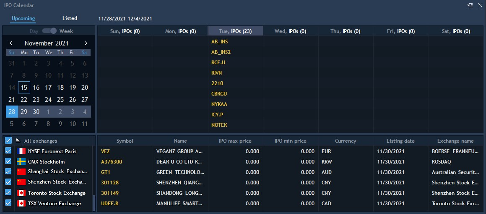
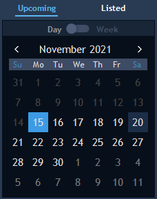

# IPO calendar

The IPO Calendar panel displays initial public offering of stocks on different exchanges in an easy-to-use functional calendar. In order to start using the IPO calendar, select it from the Tools drop-down list located in the terminal main menu. The general view of this panel is as follows:

Upper left part of the panel offers “Upcoming” and “Listed” tabs, which allow switching the calendar display mode:

* Upcoming – displays companies whose listing date is yet to come (awaiting IPO);
* Listed – displays companies the listing date of which has already come (IPO has passed).

The panel itself includes three main parts:

* Filter section – contains a calendar for selecting the date/week for which the information on IPOs will be shown;
* Exchange section – filter control for selecting the exchanges on which the IPO is listed;
* Table section – displays the main part of information (described below).

### Upcoming tab

Filter section contains a calendar that allows switching between displaying information for a specific day or week, to do this, use the special switcher located above the calendar:

The Exchange section allows displaying information for the required exchanges only, simply check those of interest and the table will be refreshed:

.jpg>)

When the **Day mode** is selected for the calendar, the table contains the following informational columns (to enable/disable column displaying, right-click the table header):

.jpg>)

* Symbol – displays instrument name;
* Name – full instrument name, i.e. its description;
* IPO max price – displays maximum price for this IPO;
* IPO min price – displays minimum price for this IPO;
* Currency – displays currency of certain IPO;
* Listing date – listing date of the certain IPO;
* Exchange name – exchange on which this IPO will be listed.

If the **Week mode** is selected, the entire calendar week will be highlighted when clicking a certain day in the calendar. Please note that the regional format (Mon-Sun or Sun-Sat) is also considered here.

In this mode, the table is divided into two blocks. The first block displays each day of the selected week with a catalogue of IPOs that will be listed on that day. The second, lower block, displays columns with information as for the normal Day mode:

.jpg>)

Select the required day in the upper table part to display the relevant data for it in the lower part. The table header in this mode also displays the dates of the week selected in the calendar .

### Listed tab

This tab contains the same controls as for the Upcoming tab (described above), however, the contents of the table differ, since it displays IPOs that have already been listed, that is, only past dates can be selected. Double-clicking on one of the Instruments will open its chart.

Please note that this tab is always in the “Week” mode and does not have a corresponding switcher:

.jpg>)

The table itself contains the following columns (to enable/disable column displaying, right-click the table header):

* Symbol – displays instrument name;
* Name – full instrument name, i.e. its description;
* Listing date – date on which the IPO was listed;
* Initial price – initial IPO price;
* Price – current instrument price;
* First day change – price change as a percentage relative to the listing date;
* Since IPO – change between the initial price per share on the IPO listing date and the current instrument price as a percentage;
* Currency – displays currency of certain IPO;
* Exchange name – exchange on which this IPO is listed;
* 30/60/120d Ranking – “Change,%” between the initial price per share on the IPO release day and the closing price on the day of listing.

### Settings

IPO calendar has two settings screens, both of them can be opened from the corresponding panel’s context menu. Similar configurable parameters can be set for **Upcoming** or **Listed** tables:

.jpg>)

General tab:

* View:

1. Grid – drop-down list for selecting table grid type;
2. Autosize of columns – automatically sizes columns so that their total width would be equal to the width of a panel. If disabled, each column will be sized by maximum length;
3. Auto re-sorting – enables auto re-sorting a table after any changes;
4. Show totals – allows displaying total amount for columns.

* Colors:

1. Table – coloring scheme for the table;
2. Grid – coloring scheme for the grid;
3. Row – coloring scheme for rows;
4. Selected row – coloring scheme for the highlighted row;
5. Header row – coloring scheme for the top row;
6. Total row – coloring scheme for the total's row.

The "Columns" tab offers color settings for each row, namely: the font and filling can be customized.

Coloring rows – standard settings for customizing the coloring scheme for table rows.
