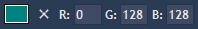
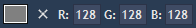
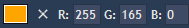
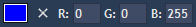
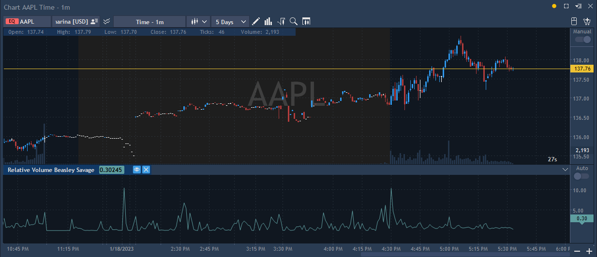

# RVOL (Relative Volume) & RVOLBS (Relative Volume Beasley Savage)

Relative Volume (RVOL) is an indicator that visually shows how current trading volume is compared to past trading volume over a given period. To be more precise, the indicator compares volume data for each price bar with the average volume over a specified number of prior bars. The RVOL ratio produced allows users to easily spot setups where unusually high or low volume is powering a price move. When the indicator value is greater than 1, the volume is higher than average, a value less than 1 means lower than average volume.

The indicator looks as follows on the chart:

<figure><figcaption></figcaption></figure>

### Lines of RVOL indicator

The indicator has 7 lines and each of them has its own features: 

<table data-header-hidden><thead><tr><th width="118"></th><th width="121"></th><th width="155"></th><th width="161"></th><th></th></tr></thead><tbody><tr><td><strong>Number of line</strong></td><td><strong>Type of line</strong></td><td><strong>Colour of line</strong></td><td><strong>Line name</strong></td><td><strong>Description</strong></td></tr><tr><td>1</td><td></td><td></td><td>volume_positive</td><td>The current value of the volume is plotted if at least one of the alerts <strong>Use Static Volume for Alerts? / Use RVOL For Alerts? / Use Lookback For Alerts?</strong> is executed</td></tr><tr><td>2</td><td></td><td></td><td>volume_negative</td><td>The current value of the volume is plotted if none of the alerts <strong>Use Static Volume for Alerts? / Use RVOL For Alerts? / Use Lookback For Alerts?</strong> is executed</td></tr><tr><td>3</td><td></td><td></td><td>ma</td><td>SMA value</td></tr><tr><td>4</td><td></td><td></td><td>rvol</td><td>RVOL value</td></tr><tr><td>5</td><td></td><td></td><td>volume_threshold</td><td>Value of <strong>Absolute RVOL Level To Trigger Signal</strong></td></tr><tr><td>6</td><td></td><td></td><td>rvol_threshold</td><td>Value of <strong>Absolute RVOL Level To Trigger Signal</strong> multiplied by the moving average</td></tr><tr><td>7</td><td></td><td></td><td>lookback_threshold</td><td>Maximum volume for <strong>Highest Volume Lookback period</strong></td></tr></tbody></table>

### Rules for rendering of values on indicator lines

If the line Visible = active, then the following rules will be applied:

* On **ma** line (line 3), the value of the Moving Average is plotted.
* On **rvol** line (line 4), the value of RVOL is plotted.
* If at least one of the alerts **Use Static Volume for Alerts? / Use RVOL For Alerts? / Use Lookback For Alerts?** is activated and at the same time the alert(s) condition is met, then:
  * if **true**, then:
* the value of the current volume is plotted in the **volume\_positive** line (line 1)
* the text "VOL signal for \<instrument name>" is triggered for each new bar, and it meets the conditions of the specified alerts
  * if **false**, then the value of the current volume is plotted in the **volume\_negative** line (line 2)
* If **Draw RVOL Threshold?** and **Use Static Volume for Alerts?** are activated at the same time, then:
  * **Absolute RVOL To Trigger Signal** will be plotted on the line **volume\_threshold** (line 5)
  * On **rvol\_threshold** line (line 6) the **Absolute** **RVOL To Trigger Signal** value is plotted and multiplied by the moving average at this point
* If **Draw RVOL Threshold?** and **Use Lookback For Alerts?** are activated at the same time, then in **lookback\_threshold** line the maximum volume for the **Highest Volume Lookback period** is displayed.

### Calculation

The indicator is not calculated for bars, sequence number of which is less than MA Length.

When the volume value is N/A, then such a bar is not included in the calculation and is ignored.

For each bar:

* A moving average is calculated taking into account the type selected in “MA Type” and the calculation period of “MA Length”.
* RVOL is calculated using the following formula:

_**RVOL = Volume / SMA**_ ,

where:

* Volume - current value of volume;
* SMA - moving average. If SMA = 0, then RVOL = 0.

### Main parameters

* Highest Volume Lookback period - the number of bars to be displayed and compared with the current bars.
* MA Length - the number of bars that are involved in the calculation of the moving average.
* MA Type - type of moving average. Default value is EMA. Possible values:
  * EMA - Exponential Moving Average
  * SMA - Simple Moving Average
  * HMA - Hull Moving Average
  * WMA - Linear Weighted Moving Average
  * DEMA - Double Exponential Moving Average
* Absolute Volume Level To Trigger Signal - a user needs to specify the volume of bars with the volume higher or equal to the current volume.
* Absolute RVOL Level To Trigger Signal - the volume that triggers the signal.

**Controls for determining the colouring of bars:**

* Use Static Volume for Alerts? - allows colouring bars with the volume higher or equal to the value **Absolute Volume Level to Trigger Signal**.
* Use RVOL For Alerts? - allows colouring bars with the volume higher or equal to the value **Absolute RVOL Level To Trigger Signal**.
* Use Lookback For Alerts? - allows displaying RVOL calculations for the last **Highest Volume Lookback period bars**.
* Draw RVOL Threshold? - allows plotting the maximum volume value for the **Highest Volume Lookback period**.

The screenshot below provides an example of settings that can be configured. The following lines are activated in the indicator settings: volume\_positive / volume\_negative / ma / rvol .

<figure><figcaption></figcaption></figure>

## RVOLBS (Relative Volume Beasley Savage)

The common feature between RVOLBS and RVOL indicators is that they calculate relative volume. The difference between these indicators is that RVOLBS only calculates the relative volume for the last N days (N is set in the Volume length parameter).

### Calculation

The indicator value is the ratio of the volume of the current bar to the value of the moving average by volume for the period of Volume Length.

### Main parameters

Volume Length - the number of bars involved in the calculation of the simple moving average.

The indicator looks as follows on the chart:

<figure><figcaption></figcaption></figure>

 

\
\
 
