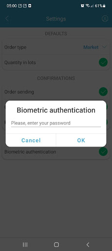
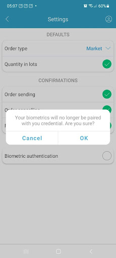
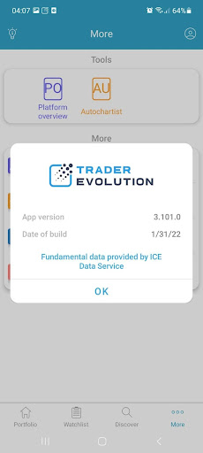

# More

The section contains the tools, settings and general information about the application:

<figure><figcaption></figcaption></figure>

* Active trading/Investing - this segment control allows going back to the trading application;
* Rate us - allows to rate the app in the Google play or Apple app store and leave the feedback via email;
* MAM summary - tab shows statistics for those accounts which are under the control of the MAM manager;
* Settings - allows accessing the app settings;
* About - allows viewing the application version info;
* Log out - allows logging out of the application.

### **IPOs**

The IPOs feature offers a list of initial public offering of stocks for different exchanges in an easy-to-use functional form. In order to start using it, select the IPOs option from the Tools section. The general view of this panel is as follows:

.png>)

The upper part of this panel offers a feed with a list of countries for which the IPOs can be displayed:

.png>)

Select the country of interest and panel data will be automatically refreshed in accordance with your pick. In order to scroll the list of available countries, simply swipe them to the left.&#x20;

Upper part of the panel offers two tabs “Upcoming” and “Listed”, which allow displaying corresponding data lists:

* Upcoming – displays companies for which a listing date is yet to come (awaiting IPO);
* Listed – displays companies the listing date of which has already come (IPO listed).

The “Upcoming” tab (can be seen on the picture above) displays info about the companies that are currently awaiting IPO. The list is filtered by the country to which the company belongs and displays data for the last 30 days. The following info columns are available in the tab:

* Symbol – displays instrument name;
* Price – displays min/max price for this IPO;
* Listing – listing date for each IPO.

Tapping on any instrument card will bring up an info pop-up with a bunch of useful details on the selected IPO:

.png>)

* Symbol logo/name/description – symbol info, displayed at the top;
* IPO max/min – minimum and maximum prices for this symbol's IPO;
* Exchange – displays the exchange on which this IPO is listed;
* Listing – displays a date on which this IPO will be listed;
* Currency – quoting currency of this symbol.

The “Listed” tab, respectively, displays IPOs that have already been listed, this information is only available for past dates. In order to select the required date, use the period selector, which can be opened by tapping on the calendar icon in the upper right part of the panel. Three display modes are available here: 1 day ago, Week to yesterday, and Month to yesterday. The general view of this panel is as follows:

.png>)

The following information is available in this tab:

* Symbol – displays instrument name;
* Last price – last available instrument price;
* Listing – date on which the IPO was listed.

Tapping on the instrument card will bring up the info pop-up, just like for the Upcoming tab, but it will contain another information this time:

.png>)

* Symbol logo/name/description – symbol info, displayed at the top;
* Initial/Last prices – initial and current IPO prices;
* Exchange name – displays the exchange on which this IPO is listed;
* Listing – displays a date on which this IPO was listed;
* First day change  – price change as a percentage relative to the listing date;
* Since IPO – change between the initial price per share on the IPO listing date and the current instrument price as a percentage.

### **Notifications**

The Notifications panel displays the history of all received messages addressed to this User sorted by their categories. In order to open this panel, click the envelope icon located in the application header. Please note that in case the User has some unread messages, this will be indicated in the special circle near the icon:

<figure><figcaption></figcaption></figure>

The following screen will be opened by selecting the Notifications icon:

<figure><figcaption></figcaption></figure>

The main screen of this panel contains toolbar and message cards, in order to display the message body itself you should tap on one of them.&#x20;

The categories to which certain messages belong are displayed here. In order to be subscribed to some categories, the User should activate them in the Subscriptions tab (or in the General settings of the application, configured by the admin), that is, the User should have a subscription to a category in order to receive its messages.

Tap on the required category to select it, swipe categories to the right to find the ones that didn't fit in the list. Each category has its own color assigned by the admin, uncategorized items are gray.

When the user selects a particular category, only cards of this category will remain in the panel, their grouping occurs by name. The rest of the cards will be hidden. To display all cards, regardless of their category, select the “All” item.

Message card contains topic and preview of the received notification. The time of message receiving is indicated in the upper right corner, it will display simply time in case the message was received today, or time and date in case it was received in the previous dates.

The message card is also colored in category colors, and after reading it becomes a neutral gray color which allows the User to easily identify the status of this message. Even when read, the card will still retain a small colored strip on the left side to indicate that it belongs to one category or another:

<figure><figcaption></figcaption></figure>

Opening the message card will proceed the User to the main text field, where the topic of the message is at the top and the text itself follows it:

<figure><figcaption></figcaption></figure>

### **Settings**

_Defaults_

This settings section allows adjusting the following:&#x20;

* Order type - allows selecting one of the following orders: Market or Limit; &#x20;
* Quantity in lots - if checked, quantity is displayed in lots, if unchecked – in units;
* Overnight execution by default - if active, all new orders will be eligible for overnight execution automatically.&#x20;

_Confirmations_

This section allows to enable double-checking of the following actions by marking them as checked, after what the application will ask you to confirm these actions: &#x20;

* Order sending;&#x20;
* Order canceling;&#x20;
* Position closing.

_Other_

This settings section cannot be displayed in the application settings if the biometric authentication is not checked in the system settings of the device or it is blocked.

Biometric authentication enables a user to log in to the mobile application more securely by using the Fingerprint or FaceID features.

To apply Fingerprint in the application for subsequent logins, a user should put his finger on the sensor. After this, the checkbox More -> Settings -> Other -> Biometric authentication becomes True. A user should enter his password to confirm biometrics:

On subsequent calls of the Login screen form, if the Biometric authentication setting is checked in the application, then the dialog box is automatically displayed to confirm biometrics.&#x20;

The user authentication occurs after putting a finger on the sensor and successful fingerprint recognition.&#x20;

In case the FaceID feature is available and activated on the user device, it can be used as an additional application login option instead of the Fingerprint. To deactivate Biometric authentication, uncheck the corresponding setting and then tap the "OK" button on the undermentioned screen:


When there is no Internet connection, users with logging enabled are not allowed to change settings.


### About&#x20;

The About screen allows viewing the app version information.

