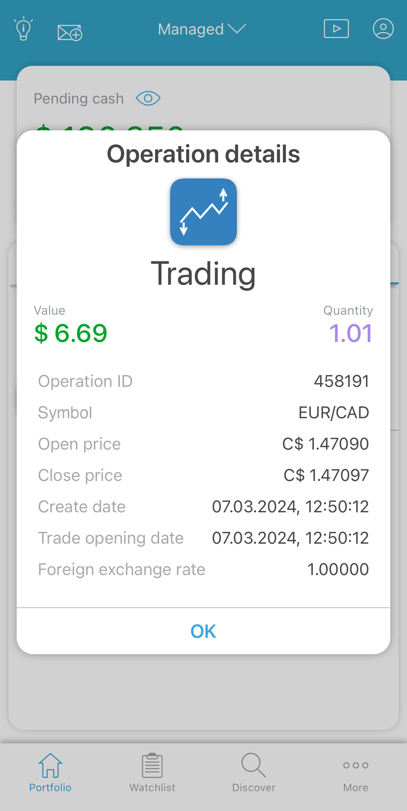

# Operations

This tab shows the information about the completed account operations:

<figure><figcaption></figcaption></figure>

Each card contains the following data:

* Operation type - type of the completed operation. The following operation types are available: Deposit, Withdrawal, Transfer, Blocking, Unblocking, Trading, Swap, Custodial, Funding;
* Date - time and date when the operation was completed;
* Value - the price shown in the account’s currency.

To see operation details, swipe the card left and tap  button:

<figure><figcaption></figcaption></figure>

Note that the user can select a data range for which the operations will be shown. Tap the button to choose the range:

<figure><figcaption></figcaption></figure>

Also a user can group the operations, to do this tap on the grouping  button and select the needed option: 

<figure><figcaption></figcaption></figure>
