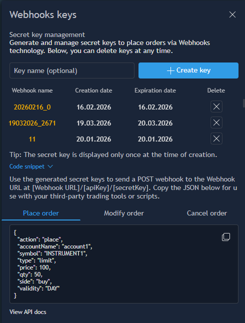

# Webhooks keys

A webhook is a mechanism that allows one system to automatically send data or requests to another system via HTTP when a specific event occurs. Webhooks are commonly used for integrating different services and enabling real-time communication between systems without the need for manual actions or periodic requests. Using webhooks, external systems can trigger actions automatically. This approach simplifies system integration, enables automation of workflows, and allows operations to be executed when required. Below in the article you will find the examples of webhooks usage.

The Webhooks keys panel allows the user to generate and manage secret keys used to place trading orders from external systems. Using webhook requests with generated keys allows sending order requests to the TE system without using the User’s login and password.

To open the panel, go to the Accounts -> Webhooks section of the terminal. The panel contains tools for creating webhook keys, viewing existing keys, and deleting them if necessary and has the following view:

<figure><figcaption></figcaption></figure>

The panel contains following elements:

* Key name (optional) – text field for specifying a custom name for the webhook key. This field is optional and if left empty the random name will be generated for the key;
* Create key – button used to generate a new webhook key. After clicking this button, the system creates a new API key and secret key for webhook trading;

Below there is a table displaying all webhook keys created by the user. It contains the following columns:

* Webhook name – displays the name assigned to the webhook key;
* Creation date – displays the date when the webhook key was created;
* Expiration date – displays the date when the webhook key will expire. If no expiration date is defined then the key will be valid without expiration;
* Delete – removes the selected webhook key.

Below the table, the panel also contains the Code snippet section. This section provides example snippets of webhook requests that should be used when configuring external trading systems or automation tools.

The section includes several tabs corresponding to different trading actions, such as Placing, Modifying or Canceling orders. The View API docs link allows users to access more detailed documentation.

By clicking the  button the keys will be generated and the confirmation pop-up containing the newly created webhook credentials will be displayed:

<figure><figcaption></figcaption></figure>

It consists of the following fields:

* Name – the name assigned to the webhook key;
* API key – the public identifier used for webhook authentication;
* Secret key – the private key used together with the API key to authenticate requests;
* Webhook URL – the URL that external systems should use to send webhook requests. This URL includes the API key and secret key required for authentication.

The pop-up also provides standard controls:\
Show/Hide  – allows temporarily displaying or hiding the key value;\
Copy  – copies the value to the clipboard.


It’s important to note that after closing this window, the generated keys will no longer be displayed in the terminal!


### Webhook trading

To use webhook trading, you need to configure your external system so that it sends an HTTP request to the Webhook URL mentioned in the Webhooks panel. This request must contain a JSON body describing the trading action to be performed. See more detailed instructions below.


Please note that the user must be subscribed to the Trading Webhooks product to use the webhook mechanism.


**1. Generate the Webhook keys**

Open the “Webhooks keys” panel in the Accounts section and click “Create key” button to generate new API and secret keys:

<figure><figcaption></figcaption></figure>

**2. Copy the generated Webhook URL**

Use the generated URL in your external system as the destination for webhook requests:

<figure><figcaption></figcaption></figure>

The Webhook URL has the following format:

https://\<server-address>/webhook/{apiKey}/{secretKey}

Where:

* apiKey – the public identifier;
* secretKey – the private key used to authenticate the request.

**3. Configure the webhook sending in external system**

Let’s consider an example of configuring an alert in TradingView for a specific instrument and condition.

Once the alert is created, enable the option that allows sending a webhook request to the URL when the alert is triggered and specify the Webhook URL mentioned in the Webhooks keys panel. Please note that requests must use the POST method:

<figure><figcaption></figcaption></figure>

**4. Configuring the request message**

The next step is to configure the request message, which defines the trading action that will be performed when the alert is triggered and the request is sent.

For example, in TradingView, this is done in the “Message” section when creating or editing an alert, where you can insert a JSON-formatted request:

<figure><figcaption></figcaption></figure>

The webhook can perform different operations such as:

* Place order;
* Modify order;
* Cancel order.

Examples of all 3 actions messages and their parameters are below:

**Place order**

<table><thead><tr><th width="249">Name</th><th>Type</th><th>Description</th></tr></thead><tbody><tr><td><code>action*</code></td><td>string/body</td><td>Action type. Must be "place".</td></tr><tr><td><code>accountName*</code></td><td>string/body</td><td>Identifier of the account for which the order is submitted.</td></tr><tr><td><code>symbol*</code></td><td>string/body</td><td>Instrument name (uppercase).</td></tr><tr><td><code>symbolType</code></td><td>string/body</td><td>Instrument type. Possible values: CRYPTO, EQUITY, EQUITY_CFD, ETF, FIXED_INCOME, FOREX, FUTURES, FUTURES_CFD, OPTIONS, SPREADBET</td></tr><tr><td><code>contractMonth</code></td><td>string/body</td><td>Final delivery date. Required for FUTURES, FUTURES_CFD, OPTIONS.</td></tr><tr><td><code>strikePrice</code></td><td>number/body</td><td>Strike price. Required for OPTIONS.</td></tr><tr><td><code>strikeType</code></td><td>string/body</td><td>Put or Call. Required for OPTIONS.</td></tr><tr><td><code>isin</code></td><td>string/body</td><td>ISIN identifier.</td></tr><tr><td><code>type*</code></td><td>string/body</td><td>Order type: Market, Stop, Limit, Stop limit, Trailing stop, Care.</td></tr><tr><td><code>price</code></td><td>float/body</td><td>Price at which the order should be placed.</td></tr><tr><td><code>stopPrice</code></td><td>float/body</td><td>Stop price for the order.</td></tr><tr><td><code>qty*</code></td><td>float/body</td><td>Quantity of the order.</td></tr><tr><td><code>side*</code></td><td>string/body</td><td>Order side: buy / sell.</td></tr><tr><td><code>cashOrderQty</code></td><td>float/body</td><td>Cash quantity of the order.</td></tr><tr><td><code>validity</code></td><td>string/body</td><td>Validity type (DAY, GTC, IOC, GTD, FOK, GTS).</td></tr><tr><td><code>expireDate</code></td><td>integer/body</td><td>Expiration timestamp in milliseconds (used with GTD).</td></tr><tr><td><code>stopLoss</code></td><td>float/body</td><td>Stop loss price.</td></tr><tr><td><code>stopLossType</code></td><td>string/body</td><td>Stop loss type (absolute, offset in ticks, tr. offset, offset in %).</td></tr><tr><td><code>takeProfit</code></td><td>float/body</td><td>Take profit price.</td></tr><tr><td><code>takeProfitType</code></td><td>string/body</td><td>Take profit type (absolute, offset in ticks, offset in %).</td></tr><tr><td><code>trStopOffset</code></td><td>float/body</td><td>Trailing stop offset.</td></tr><tr><td><code>userComment</code></td><td>string/body</td><td>Additional order comment (Care orders only).</td></tr></tbody></table>

**Request body**

```json
{
  "action": "place",
  "accountName": "demo",
  "symbol": "ABC",
  "symbolType": "CRYPTO",
  "type": "Limit",
  "qty": 5,
  "side": "buy",
  "price": 34
}
```

**Response**

```json
{
  "s": "ok",
  "d": {
    "orderId": "3188861",
    "action": "place",
    "symbol": "ABC",
    "symbolType": "CRYPTO",
    "type": "limit",
    "qty": 5,
    "side": "buy",
    "price": 34,
    "accountName": "demo"
  }
}
```

**Modify order**

<table><thead><tr><th width="249">Name</th><th>Type</th><th>Description</th></tr></thead><tbody><tr><td><code>action*</code></td><td>string/body</td><td>Action type. Must be "modify".</td></tr><tr><td><code>accountName*</code></td><td>string/body</td><td>Identifier of the account for which the order modification is submitted.</td></tr><tr><td><code>orderId*</code></td><td>integer/body</td><td>Identifier of the order to be modified.</td></tr><tr><td><code>price</code></td><td>float/body</td><td>New price of the order.</td></tr><tr><td><code>stopPrice</code></td><td>float/body</td><td>Updated stop price for the order.</td></tr><tr><td><code>qty</code></td><td>float/body</td><td>Updated quantity of the order.</td></tr><tr><td><code>validity</code></td><td>string/body</td><td>Validity of the order (e.g., DAY, GTC, IOC, GTD, FOK, GTS).</td></tr><tr><td><code>expireDate</code></td><td>integer/body</td><td>Expiration timestamp in milliseconds. Used only when the validity type is GTD.</td></tr><tr><td><code>stopLoss</code></td><td>float/body</td><td>Updated stop loss price.</td></tr><tr><td><code>stopLossType</code></td><td>string/body</td><td>Type of the stop loss (absolute, offset in ticks, tr. offset, offset in %).</td></tr><tr><td><code>takeProfit</code></td><td>float/body</td><td>Updated take profit price.</td></tr><tr><td><code>takeProfitType</code></td><td>string/body</td><td>Type of the take profit (absolute, offset in ticks, offset in %).</td></tr><tr><td><code>trStopOffset</code></td><td>float/body</td><td>Updated trailing stop offset.</td></tr><tr><td><code>userComment</code></td><td>string/body</td><td>Additional order comment (Care orders only).</td></tr></tbody></table>

**Request body**

```json
{
  "action": "modify",
  "accountName": "demo",
  "orderId": 3188861,
  "price": 35,
  "qty": 10
}
```

**Response**

```json
{
  "s": "ok",
  "d": {
    "orderId": "3188861"
  }
}
```

**Cancel order**

<table><thead><tr><th width="249">Name</th><th>Type</th><th>Description</th></tr></thead><tbody><tr><td><code>action*</code></td><td>string/body</td><td>Action type. Must be "cancel".</td></tr><tr><td><code>accountName*</code></td><td>string/body</td><td>Identifier of the account for which the order is submitted.</td></tr><tr><td><code>orderId*</code></td><td>integer/body</td><td>Identifier of the order to cancel.</td></tr></tbody></table>

**Request body**

```json
{
  "action": "cancel",
  "accountName": "demo",
  "orderId": 3188861
}
```

**Response**

```json
{
  "s": "ok",
  "d": {
    "orderId": "3188861"
  }
}
```

As a result, you will receive a status indicating the outcome of the request. The status will be ok if the operation was successful, and error if there was an issue. If an error occurs, a description of the error will be provided in the errmsg field.

**5. Order execution**

When the alert condition is met, the external system automatically sends the HTTP request to the webhook URL with specified body message.

If the request is valid and the authentication keys are correct, the server processes the request and executes the specified trading action (for example, placing an order):

<figure><figcaption></figcaption></figure>
