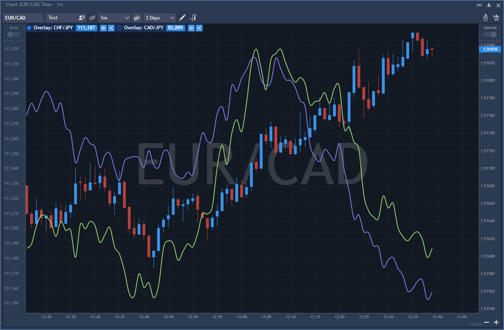

# Chart overlay

A user can add any other Symbols to the current chart. To provide this, click on the.png>) button located near the Symbol lookup. Select a new symbol to integrate into the chart.

The menu of the overlaid symbol contains the following buttons:

.png>)

*   Visible.png>)

    – if checked, the price scale of the selected overlaid symbol will be shown on the chart;
* Hide/Show.png>)– allows to hide or show overlaid symbol on the chart;
* Remove overlay.png>)– allows removing the overlay in one click.

A user can select the following overlay settings:

.png>)

* Symbol – allows selecting symbol for overlay.
* Data type – type of data which will be displayed: Bid, Ask, Last.
* Price scaling – user can select separate or main scale for displaying.
* Style – style of the chart displaying: candle, line, bar, etc.
* Body, Border, Wick, Doji, Histogram Line, Line, Area – allows setting the color according to the chart style.
* Show price marker – allows displaying price marker for overlaied symbol.
