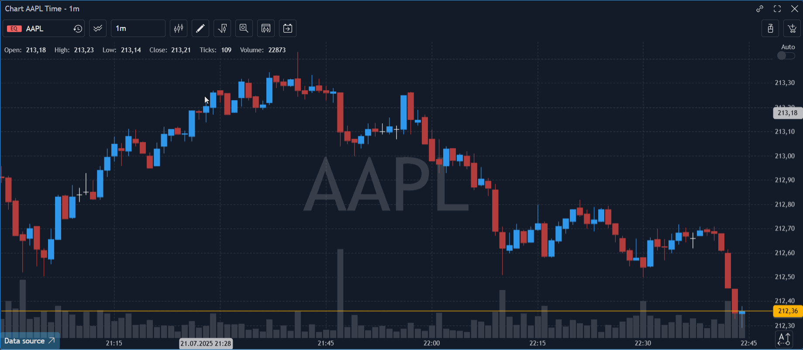

# Drawings

A set of graphical tools is available to assist in price movements analysis. All of these tools are accessible via the Drawing toolbar or through the Context menu of the Chart.

<figure><figcaption></figcaption></figure>

The following list of graphical tools is currently available:

Trend tools:

* Horizontal line – places a horizontal line on the chart that can be extended to the left in order to monitor starting points of levels plotting on the chart history (option 'Extend left' in the settings);
* Vertical line – places a vertical line on the chart;
* Line – places a line on the chart that may be extended beyond both sides with an option to show the angle of the trend (set in the settings);
* Price channel – places levels on a trend line;
* Regression channel – consists of two parallel lines plotted equidistantly above and below a Regression line. User can specify begin and end points of regression line: these will be snapped to the closest bars. The slope of the lines will be automatically adjusted based on linear regression;
* Andrew's pitchfork – places Andrew's channel Polygon;

Geometry tools:

* Triangle – places a simple triangle on the chart;
* Rectangle – places a simple rectangle on the chart;
* Circle – places a circle on the chart;
* Ellipse – places an ellipse on the chart;
* Polygon – places a polygon figure on the chart;

Fibonacci tools:

* Fibonacci retracement – retracement and price goals;
* Fibonacci expansion – estimating support and resistance levels;
* Fibonacci arc – places arcs with Fibonacci levels;
* Fibonacci ellipses – identifies underlying structure of price movements;
* Fibonacci spiral – places a spiral with Fibonacci levels as steps;
* Fibonacci fans – places Fibonacci angles;
* Fibonacci phi-channel – places Fibonacci levels on a trend line;
* Fibonacci time goal analysis – places time goals;
* Fibonacci time zone – measures Fibonacci periods.

Gann tools:

* Gann line – places a line drawn at the angle of 45 degrees;
* Gann fan – places a series of diagonal lines;
* Gann grid – places trends at the angle of 45 degrees.

Elliott Wave:

* Elliott Impulse Wave(12345) — allows placing five waves on the chart in the direction of the main trend.
* Elliott Correction Wave (ABC) — allows placing three waves on the chart in the opposite direction from the main trend.
* Elliott Triangle Wave (ABCDE) — allows placing five secondary waves on the chart in the direction of the main trend.
* Elliott Double Combo Wave(WXY) — allows placing three secondary waves on the chart in the opposite direction from the main trend.
* Elliott Triple Combo Wave(WXYXZ) — allows placing five corrective waves on the chart.

Secondary tools:

* Arrow – adds an arrow on the chart;
* Ruler – measures distance, i.e. displays the time passed between the ruler endpoints. Lower part diplays price difference between endpoints numerically and as percentage (displayed in brackets);
* Comments – places a small text box for remarks. Double click it to edit a text;
* Price label – places a certain price label on a chart.

Properties:

* Selection – selects more than one drawing on the chart;
* Remove – removes drawings from the chart.


In order to place a tool:

Open Context menu and select Drawing tools -> \[desired tool] or click on an appropriate icon in the Drawing toolbar.

### **Context menu**&#x20;

Each drawing tool has its Context menu. Right-click on the initial point of the drawing tool in order to evoke its context menu.

<figure><figcaption></figcaption></figure>

* Settings – allows to specify tool’s appearance and settings;
* Clone – allows to create the same drawing as selected one;
* Remove – removes selected tool.


Drawing's Settings menu contains different sections depending on drawing's type. In general, it allows to select the style of a drawing.

<figure><figcaption></figcaption></figure>
