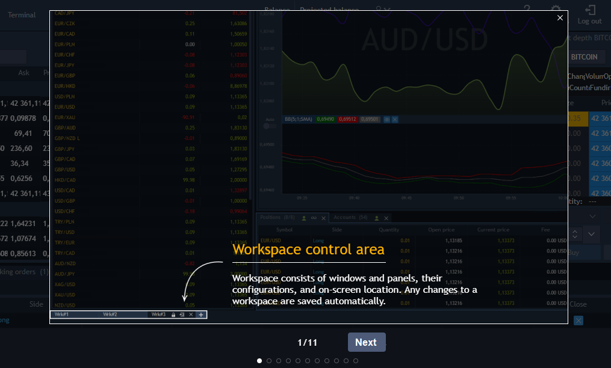
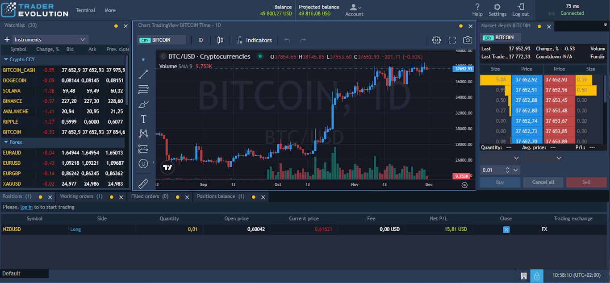

# Explore the app

Explore the app option provides an opportunity for the unregistered users to familiarize with the application interface and some part of the functionality.

Explore the app button can be found at the bottom of the login screen:

<figure><figcaption></figcaption></figure>

Clicking on the button will open a demo version of the application with limited functionality.

By opening the demo version of the app, Onboarding with basic hints will be shown:

<figure><figcaption></figcaption></figure>

The main screen of the demo version is similar to the real application so that the user can familiarize himself with the VelocityTrader system as much as possible:

<figure><figcaption></figcaption></figure>

The main limitation of using the demo version is that the user will not be allowed to trade or change any application settings. The buttons responsible for these functions will either be disabled or the user will be asked to log in.

The list below describes the main tools and their limitations:

* Table panels - columns in the table and their locations can be changed. Note that these changes will be stored locally and for this session only. After the next login via the Explore the app mode, settings will be reset to the defaults;
* Watchlist - it is possible to use the Watchlist tool. New symbols can be added and deleted from the table, but the watchlist will have a default state after the next login;
* Chart - Chart tool works the same as in the real application except that the account cannot be changed. Also, when trying to trade, the user will be notified with the following message: Please log in to start trading;
* Market depth - the panel is available, but orders cannot be placed from it, when the user presses the Buy or Sell, he will be notified with the following message: Please log in to start trading. Also all changes that can be done via Market depth context menu (Settings/View) will be stored locally and for this session only;
* Positions - when opening the demo version, some positions are opened without the possibility to close them, as all trading functionality is disabled;
* Orders - same as for positions, there are some working orders that can’t be canceled;
* Assets - shows some assets that are available for the guest users;
* News - shows some news that are available for the guest users;
* Account widget - Account widget tool works the same as in the real application except that the account cannot be changed, also Account widget can be changed, but these changes will be stored locally and for this session only. After the next login via the Explore the app mode, settings will be reset to the defaults;
* Subscriptions - the panel is available, but the Subscribe/Unsubscribe buttons are disabled. The panel has several active subscriptions initially;
* Event log - several events linked to the opened orders and positions are shown;
* Workspace settings - settings can be changed,but they will not be saved. After the next login via the Explore the app mode, settings will be reset to the defaults;
* Help - works in normal mode - brings the user to the manuals page.
